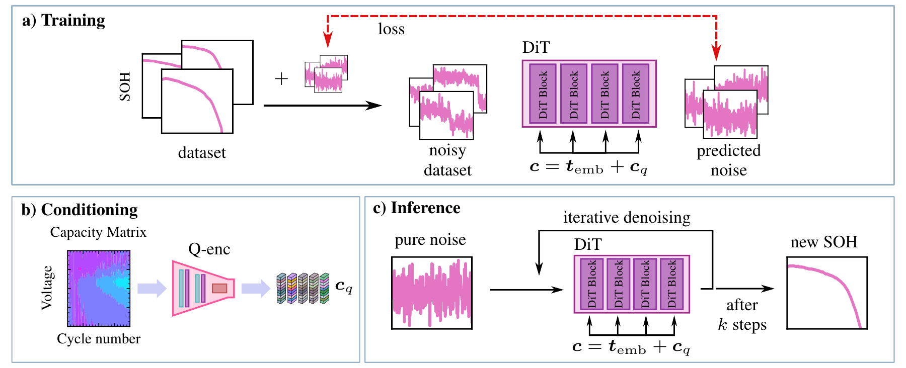
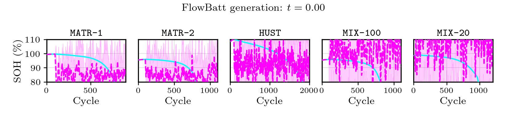

# [NeurIPS 2026] FlowBatt: Flow Matching for Probabilistic Battery Degradation Prediction

Hamidreza Eivazi, Eslam Sharaawy, Stefan Wittek, André Hebenbrock, Raphael Ginster, and Steffen Blömeke.

[Paper](https://openreview.net/forum?id=XCVKzG7HD6) · [Experiment guide](docs/experiments.md) · [Model card](MODEL_CARD.md)

FlowBatt uses conditional flow matching to generate probabilistic battery state-of-health (SOH) trajectories from early-life information. Generated trajectories support degradation forecasting, remaining useful life (RUL) prediction, empirical prediction intervals, and synthetic-data augmentation.



*Figure 1. Model architecture. Adapted and modified from [Fürrutter et al. (2024)](https://doi.org/10.1038/s42256-024-00831-9).*

## Generation process



The animation shows the evolution of generated SOH trajectories across five benchmark settings. Cyan denotes the reference, magenta the median of ten generated trajectories, and shading the pointwise 5th–95th percentile interval. The time indicator represents generative time, not elapsed inference time.

## Installation

The pinned requirements need Python 3.12 or later. From the repository root, install the requirements:

```sh
python -m pip install -r requirements.txt
```

This installs the package in editable mode and its dependencies, including those used by the CNN/XAI-CNN scripts. Keep the datasets, checkpoints, and configurations in the checkout. Dependency versions are listed in [requirements.txt](requirements.txt); use a matching PyTorch/torchvision build for your accelerator.

Datasets and checkpoints are included directly in the repository; Git LFS is not required. Plotting works without LaTeX; set `FLOWBATT_USETEX=1` to use an installed LaTeX distribution.

## Pretrained prediction

```sh
python -m flowbatt.evaluate --model flowbatt --dataset MATR-1 --num-samples 10
python -m flowbatt.evaluate --model diffbatt --dataset MATR-1 --num-samples 10
python -m flowbatt.evaluate --model transformer --dataset MATR-1 --num-samples 10
```

The evaluator reports trajectory-wise SOH error, cycle-wise SOH error, and RUL error. Trajectory SOH error is the mean of per-battery RMSEs over the full interpolated horizon, after clipping both trajectories from below at EOL, in SOH percentage points. It writes predictions and metrics to `workspaces/evaluation/<dataset>/<model>/`. Choose a new `--output` for another run. Use `--device cpu`, `--device cuda`, or `--device mps` to select a device.

FlowBatt and DiffBatt generate independent draws from one checkpoint. Transformer evaluates independently trained checkpoints. Their variability is reported separately. The generative models use the capacity matrix and the observed SOH prefix: ten downsampled points for 100-cycle inputs, or two for MIX-20. No future SOH is used for prediction.

For guided synthesis with the separate MATR-1 checkpoint, see the [experiment guide](docs/experiments.md#guided-generation-and-rf-augmentation).

## Training

```sh
python -m flowbatt.train --model flowbatt --dataset MATR-1 --device cuda
python -m flowbatt.train --model diffbatt --dataset MATR-1 --device cuda
python -m flowbatt.train --model transformer --dataset MATR-1 --device cuda
```

Defaults are 10,000 epochs for FlowBatt/DiffBatt and 1,000 for Transformer, with AdamW, learning rate 0.001, and 100 warm-up optimizer steps. Training uses the training split and saves the final epoch without test-based checkpoint selection. Add `--conditioning-dropout 0.2` to train a FlowBatt synthesis model.

Use `--checkpoint` to evaluate saved weights for any of the three models; repeat it for multiple Transformer seeds. Without this option, evaluation uses the bundled weights. See [custom-checkpoint examples](docs/experiments.md#evaluate-newly-trained-models).

## Datasets and checkpoints

| Dataset | Training cells | Test cells | Capacity matrix |
| --- | ---: | ---: | --- |
| MATR-1 | 41 | 42 | 100 × 100 |
| MATR-2 | 41 | 40 | 100 × 100 |
| HUST | 55 | 22 | 100 × 100 |
| MIX-20 | 256 | 147 | 20 × 100 |
| MIX-100 | 205 | 137 | 100 × 100 |

All experiments share the five NPZ archives in `datasets/`, loaded with `allow_pickle=False`. SOH trajectories have 256 points. Evaluation uses an 80% SOH EOL threshold, except MIX-20 at 90%. 

The repository includes 61 trajectory checkpoints: five FlowBatt, five DiffBatt, fifty Transformer models, and one MATR-1 FlowBatt synthesis model. It also includes ten XAI-CNN checkpoints. See [trajectory checkpoint details](checkpoints/README.md) and [XAI-CNN details](docs/experiments.md#scalar-cnn-and-xai-cnn).

## XAI-CNN and CNN

Evaluate the pretrained XAI-CNN models and generate Grad-CAM visualizations:

```sh
python xaicnn/evaluate.py
```

Train and evaluate XAI-CNN on any of the five datasets:

```sh
python -u xaicnn/train.py --model xai-cnn --dataset MATR-1 --device auto
python xaicnn/evaluate.py --run workspaces/xai_cnn_MATR-1
```

Use `--model cnn` for ReLU or `--model xai-cnn` for LeakyReLU(0.3). Defaults are `cnn`, `MATR-1`, seeds 0–9, and 1,000 epochs. Training saves final-epoch weights without test-based selection. Use `--help` for additional options.


## Additional experiments

The [experiment guide](docs/experiments.md) describes the baseline settings, quantile prediction intervals, and RF synthetic-data augmentation.

```sh
python -m flowbatt.experiments.full_matrix_baselines --models rf mlp --seeds 10
python -m flowbatt.experiments.quantile_baselines --models qrf qmlp --seeds 10
```

## Repository structure

```text
assets/                Architecture figure and generation animation
flowbatt/              Models, training, evaluation, and experiment runners
configs/               Model and baseline configurations
datasets/              Five shared datasets and preprocessing documentation
checkpoints/           Trajectory prediction and synthesis checkpoints
xaicnn/                XAI-CNN checkpoints and CNN/XAI-CNN training/evaluation
docs/                  Experiment protocols and reproducibility notes
```

Within `flowbatt/`, `models/` defines the networks, `config.py` loads the JSON
configurations, and `data.py` handles datasets and transforms. Training steps are
separated into `flow_matching.py`, `diffusion.py`, and `supervised.py`;
`inference.py` loads models and `sampling.py` generates trajectories.
`evaluation_metrics.py`, `postprocess.py`, and `plotting.py` provide shared
evaluation utilities. Additional experiment commands live in `experiments/`.

## Citation

```bibtex
@inproceedings{eivazi2026flowbatt,
  title = {FlowBatt: Flow Matching for Probabilistic Battery Degradation Prediction},
  author = {Eivazi, Hamidreza and Sharaawy, Eslam and Wittek, Stefan and
            Hebenbrock, André and Ginster, Raphael and Blömeke, Steffen},
  booktitle = {The Fortieth Annual Conference on Neural Information Processing Systems},
  year = {2026},
  url = {https://openreview.net/forum?id=XCVKzG7HD6}
}
```

Please cite the original dataset creators when using their data, and BatteryML/BatLiNet for the benchmark setups followed in this work.

## License

See [LICENSE](LICENSE) for code licensing and component-specific terms.
